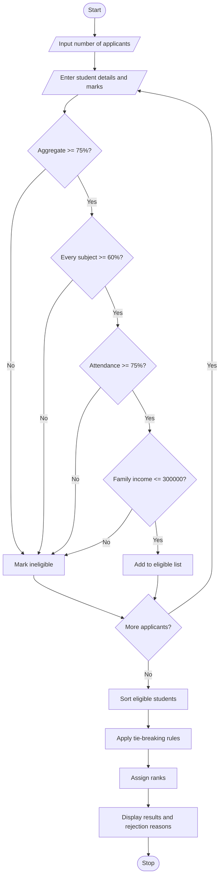

#Problem Statement
Design and implement a University Scholarship Allocation System that evaluates students based on their academic performance, subject-wise minimum marks, attendance percentage, and annual family income.

The system should:
- Accept student details, aggregate marks, subject-wise marks, attendance, and family income.
- Check whether each student satisfies all scholarship eligibility criteria.
- Reject students who fail to meet any mandatory requirement.
- Rank eligible students according to their aggregate marks in descending order.
- Resolve ties using predefined rules, such as higher attendance, higher subject-wise marks, and lower family income.
- Display the eligible students, their ranks, and the final scholarship allocation list.
Example eligibility criteria (adjust these to match your assignment):
- Aggregate marks: at least 75%.
- Minimum marks in each required subject: 60%.
- Attendance: at least 75%.
- Annual family income: not more than ₹3,00,000.
- Tie-breaking priority:
  1. Higher aggregate marks.
  2. Higher attendance percentage.
  3. Higher minimum subject mark.
  4. Lower annual family income.
# Algorithm
1. Start.
2. Read the number of student applicants.
3. For each student, input their name or ID, aggregate percentage, subject-wise marks, attendance percentage, and annual family income.
4. Check all eligibility conditions:
   - Aggregate percentage ≥ 75%.
   - Every required subject mark ≥ 60%.
   - Attendance percentage ≥ 75%.
   - Annual family income ≤ ₹3,00,000.
5. If all conditions are satisfied, add the student to the eligible list; otherwise, mark the student as ineligible and record the reason.
6. Sort the eligible students using the predefined ranking rules:
   - Aggregate marks in descending order.
   - Attendance in descending order.
   - Minimum subject mark in descending order.
   - Annual family income in ascending order.
7. Assign ranks to eligible students.
8. Display the eligible students in ranked order.
9. Display ineligible students and their rejection reasons.
10. Stop.

4. Sample Input
Enter number of applicants: 4

Student 1:
Name: Ananya
Aggregate marks: 92
Minimum subject mark: 80
Attendance: 95
Annual family income: 200000

Student 2:
Name: Rahul
Aggregate marks: 88
Minimum subject mark: 75
Attendance: 90
Annual family income: 250000

Student 3:
Name: Priya
Aggregate marks: 92
Minimum subject mark: 80
Attendance: 98
Annual family income: 180000

Student 4:
Name: Kiran
Aggregate marks: 70
Minimum subject mark: 65
Attendance: 85
Annual family income: 150000

5. Sample Output
===== UNIVERSITY SCHOLARSHIP RESULTS =====

Eligible Students (Ranked)

Rank  Name      Aggregate  Attendance  Income
1     Priya     92%        98%         Rs. 180000
2     Ananya    92%        95%         Rs. 200000
3     Rahul     88%        90%         Rs. 250000

Ineligible Students

Name: Kiran
Reason: Aggregate marks below 75%.

Scholarship allocation completed.
