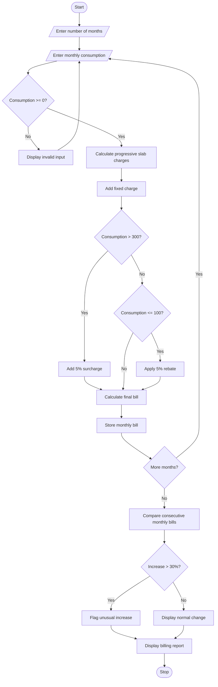

# Problem Statement
Develop a Progressive Electricity Billing System that calculates household electricity bills based on monthly electricity consumption using multiple tariff slabs. The system should include fixed charges, surcharges, and rebates while maintaining monthly billing records.

The program should:
- Accept electricity consumption in units (kWh) for multiple months.
- Calculate energy charges using progressive slabs.
- Add fixed charges and applicable surcharges.
- Apply rebates when eligibility conditions are satisfied.
- Calculate and display the final bill for each month.
- Compare bills across months and identify unusual increases in consumption or billing amounts.
Example tariff rules used in this program:
Consumption slab	Rate per unit
First 100 units	₹1.50
Next 100 units (101–200)	₹2.50
Next 300 units (201–500)	₹4.00
Above 500 units	₹6.00

Additional rules:
- Fixed monthly charge: ₹100.
- Surcharge: 5% of energy charges when consumption exceeds 300 units.
- Rebate: 5% of energy charges when consumption is at most 100 units.
- An unusual increase is flagged when the bill rises by more than 30% compared with the previous month.
These are illustrative rates, not an official electricity tariff.
# Algorithm
1. Start.
2. Input the number of months to calculate.
3. For each month, input electricity consumption in units.
4. Validate that consumption is non-negative.
5. Calculate progressive energy charges:
   - First 100 units at ₹1.50 per unit.
   - Next 100 units at ₹2.50 per unit.
   - Next 300 units at ₹4.00 per unit.
   - Remaining units at ₹6.00 per unit.
6. Add the fixed charge of ₹100.
7. If consumption exceeds 300 units, add a surcharge of 5% of energy charges.
8. If consumption is at most 100 units, subtract a rebate of 5% of energy charges.
9. Calculate the final bill.
10. Store monthly consumption and bill amounts.
11. Compare each month's bill with the previous month's bill.
12. If the increase exceeds 30%, flag the bill as an unusual increase.
13. Display monthly bills and the comparison report.
14. Stop.

Sample Input
Enter number of months: 3

Month 1 consumption: 100
Month 2 consumption: 200
Month 3 consumption: 400

5. Sample Output
===== ELECTRICITY BILLING REPORT =====

Month 1
Consumption: 100 units
Energy Charges: Rs. 150.00
Fixed Charges: Rs. 100.00
Surcharge: Rs. 0.00
Rebate: Rs. 7.50
Final Bill: Rs. 242.50

Month 2
Consumption: 200 units
Energy Charges: Rs. 400.00
Fixed Charges: Rs. 100.00
Surcharge: Rs. 0.00
Rebate: Rs. 0.00
Final Bill: Rs. 500.00
Change from previous bill: 106.19%
WARNING: Unusual increase detected!

Month 3
Consumption: 400 units
Energy Charges: Rs. 1100.00
Fixed Charges: Rs. 100.00
Surcharge: Rs. 55.00
Rebate: Rs. 0.00
Final Bill: Rs. 1255.00
Change from previous bill: 151.00%
WARNING: Unusual increase detected!

===== SUMMARY =====
Total Bills: Rs. 1997.50
Average Monthly Bill: Rs. 665.83
Unusual Increases: 2
