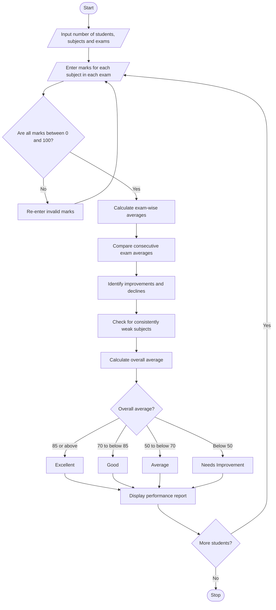

# Problem Statement
Develop a Student Performance Trend Analysis System that evaluates students' academic performance across multiple examinations and identifies improvements, declines, and consistently weak subjects.

The system should:
- Accept student names, subject names, and marks obtained in multiple examinations.
- Calculate the average score for each examination.
- Compare scores between consecutive examinations and calculate improvements or declines.
- Identify consistently weak subjects based on a predefined minimum score.
- Classify students according to their overall average performance.
- Display a performance report containing examination-wise scores, trends, weak subjects, and student classifications.
Example criteria used in this program:
Criterion	Rule
Consistently weak subject	Score below 40 in every examination
Excellent	Overall average ≥ 85
Good	Overall average ≥ 70 and below 85
Average	Overall average ≥ 50 and below 70
Needs Improvement	Overall average below 50

These thresholds are illustrative and can be changed to match your assignment requirements.
# Algorithm
1. Start.
2. Input the number of students, subjects, and examinations.
3. For each student, enter marks for every subject in each examination.
4. Validate that each mark is between 0 and 100.
5. Calculate the average score for each examination.
6. Compare consecutive examination averages:
   - If the new average is higher, record an improvement.
   - If the new average is lower, record a decline.
   - If both averages are equal, record no change.
7. For each subject, check whether its score is below 40 in every examination.
8. If the condition is satisfied, classify that subject as consistently weak.
9. Calculate the student's overall average across all subjects and examinations.
10. Classify the student as Excellent, Good, Average, or Needs Improvement.
11. Display the performance report, including averages, trends, weak subjects, and classification.
12. Repeat for all students.
13. Stop.

4. Sample Input
For simplicity, this example uses one student, three subjects, and three examinations.
Enter number of students: 1
Enter number of subjects: 3
Enter number of examinations: 3

Student name: Ravi

Subject: Mathematics
Exam 1 marks: 60
Exam 2 marks: 75
Exam 3 marks: 85

Subject: Science
Exam 1 marks: 35
Exam 2 marks: 38
Exam 3 marks: 36

Subject: English
Exam 1 marks: 70
Exam 2 marks: 65
Exam 3 marks: 60

# Sample Output
===== STUDENT PERFORMANCE REPORT =====

Student Name: Ravi

EXAMINATION-WISE AVERAGES
Exam 1 Average: 55.00
Exam 2 Average: 59.33
Exam 3 Average: 60.33

PERFORMANCE TRENDS
Exam 1 to Exam 2: Improved by 4.33 marks
Exam 2 to Exam 3: Improved by 1.00 marks

SUBJECT-WISE ANALYSIS
Mathematics: 60, 75, 85
Trend: Improved
Science: 35, 38, 36
Trend: Declined from previous exam
English: 70, 65, 60
Trend: Declined

CONSISTENTLY WEAK SUBJECTS
Science

OVERALL AVERAGE: 58.22
STUDENT CLASSIFICATION: Average
