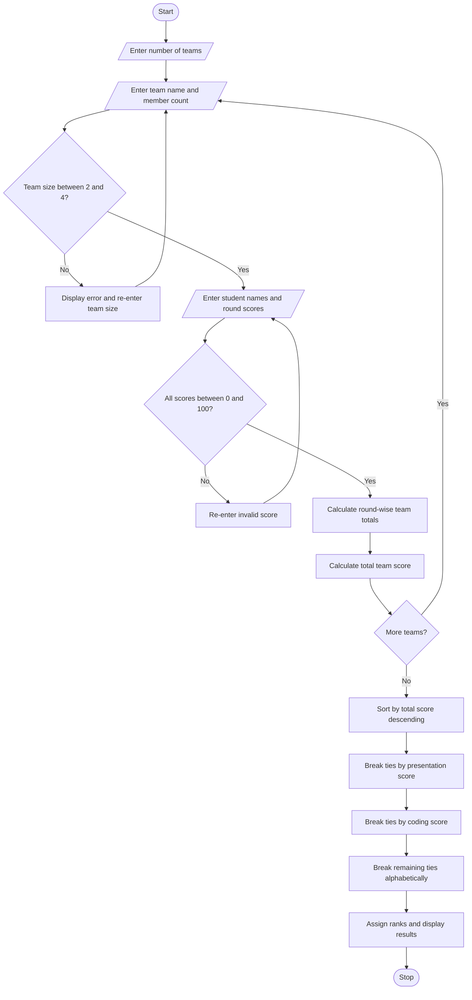

#Problem Statement
Develop a Hackathon Team Formation and Ranking System that manages student teams, validates team sizes, calculates team scores across multiple competition rounds, and ranks teams based on their overall performance.

The system should:
- Accept student details and team compositions.
- Validate that each team contains the permitted number of members.
- Record student scores across multiple hackathon rounds.
- Calculate aggregate team scores for each round and total scores.
- Rank teams in descending order of total scores.
- Resolve ties using predefined rules, such as higher final-round score, higher technical-round score, and then alphabetical team name.
- Display team compositions, round-wise scores, final rankings, and validation errors.
Example rules used in this program:
- Minimum team size: 2 students.
- Maximum team size: 4 students.
- Three competition rounds: Coding, Innovation, and Presentation.
- Each round score must be between 0 and 100 per student.
- Team round score = sum of its members' scores in that round.
- Team total score = sum of all round-wise team scores.
Tie-breaking priority:
1. Higher total team score.
2. Higher Presentation round score.
3. Higher Coding round score.
4. Alphabetically earlier team name.
These are illustrative rules that can be adjusted to your assignment requirements.
# Algorithm
1. Start.
2. Input the number of teams.
3. For each team, input its name and number of members.
4. Validate that the team size is between 2 and 4.
5. Input each student's name and scores for Coding, Innovation, and Presentation.
6. Validate that every score is between 0 and 100.
7. Calculate the team's aggregate score for each round by summing the scores of all members.
8. Calculate the total team score by adding all round-wise aggregate scores.
9. Store each team's details and scores.
10. Sort teams according to the predefined ranking rules:
    - Total score in descending order.
    - Presentation score in descending order.
    - Coding score in descending order.
    - Team name in alphabetical order.
11. Assign ranks to teams.
12. Display team compositions, round-wise scores, total scores, and rankings.
13. Display any team-size validation errors.
14. Stop.

Enter number of teams: 3

Team Name: Alpha
Number of members: 2

Student: Ravi
Coding: 80
Innovation: 70
Presentation: 90

Student: Priya
Coding: 85
Innovation: 80
Presentation: 85

Team Name: Beta
Number of members: 2

Student: Arjun
Coding: 90
Innovation: 75
Presentation: 80

Student: Sneha
Coding: 85
Innovation: 85
Presentation: 85

Team Name: Gamma
Number of members: 2

Student: Kiran
Coding: 75
Innovation: 80
Presentation: 90

Student: Meena
Coding: 80
Innovation: 75
Presentation: 85
========== HACKATHON TEAM RANKING ==========

Team: Alpha
Members: Ravi, Priya
Coding Score: 165
Innovation Score: 150
Presentation Score: 175
Total Score: 490
Rank: 1

Team: Beta
Members: Arjun, Sneha
Coding Score: 175
Innovation Score: 160
Presentation Score: 165
Total Score: 500
Rank: 1

Team: Gamma
Members: Kiran, Meena
Coding Score: 155
Innovation Score: 155
Presentation Score: 175
Total Score: 485
Rank: 3

============================================

