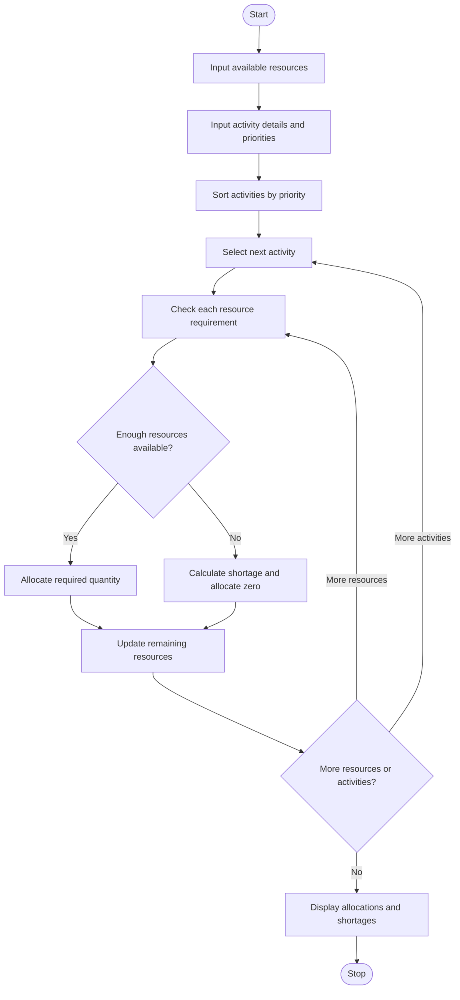

# Problem Statement
Develop a Python program to allocate campus resources, such as projectors, laptops, and microphones, across multiple activities. The program should compare each activity’s resource requirements with the available quantities, calculate shortages, and allocate resources according to a specified priority order.

The allocation must never exceed the available quantity of any resource. Activities with higher priority are considered first.

Assumptions:
- Each activity has a priority, where priority 1 is the highest.
- Activities are processed in ascending priority order.
- Resources are allocated only when the full requirement for that resource is available.
- If the full requirement cannot be met, that resource is not allocated to the activity, and the shortage is reported.
- Resources allocated to one activity are deducted from the remaining inventory.
2. Algorithm
1. Start the program.
2. Input the available quantity of each campus resource.
3. Enter the number of activities.
4. For each activity, input its name, priority, and resource requirements.
5. Sort activities by priority, from highest to lowest importance.
6. For each activity:
   - Compare each resource requirement with its remaining availability.
   - If enough resources are available, allocate the full requirement.
   - Otherwise, allocate zero of that resource and calculate the shortage.
7. Update the remaining resource quantities after each allocation.
8. Display the allocation matrix, shortages, and remaining resources.
9. Stop.

5. Sample Input
Projectors: 5
Laptops: 20
Microphones: 8

Enter the number of activities: 3

Activity 1
Activity name: Seminar
Priority: 1
Projectors required: 2
Laptops required: 8
Microphones required: 3

Activity 2
Activity name: Workshop
Priority: 2
Projectors required: 3
Laptops required: 10
Microphones required: 4

Activity 3
Activity name: Cultural
Priority: 3
Projectors required: 2
Laptops required: 5
Microphones required: 3

6. Sample Output
========== RESOURCE ALLOCATION MATRIX ==========
Activity       PriorityResource         Required  Allocated  Shortage
----------------------------------------------------------------------
Seminar                1Projectors              2          2         0
Seminar                1Laptops                 8          8         0
Seminar                1Microphones             3          3         0
Workshop               2Projectors              3          3         0
Workshop               2Laptops                10         10         0
Workshop               2Microphones             4          4         0
Cultural               3Projectors              2          0         2
Cultural               3Laptops                 5          0         5
Cultural               3Microphones             3          0         3

========== REMAINING RESOURCES ==========
Projectors: 0
Laptops: 2
Microphones: 1

========== ACTIVITIES WITH SHORTAGES ==========
Cultural - Projectors: short by 2
Cultural - Laptops: short by 5
Cultural - Microphones: short by 3

